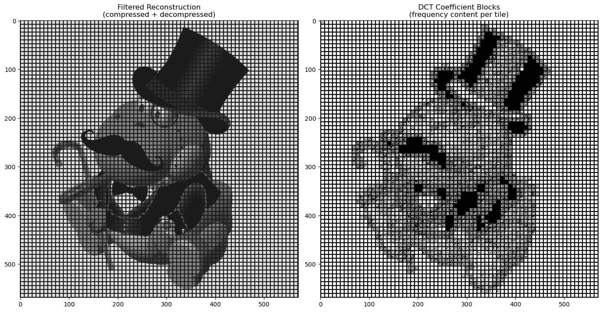
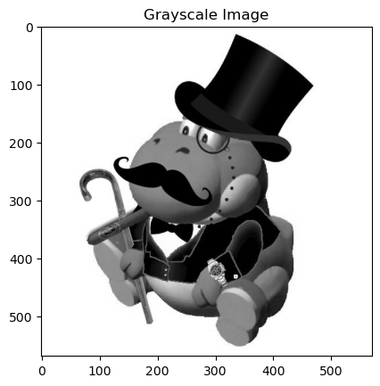
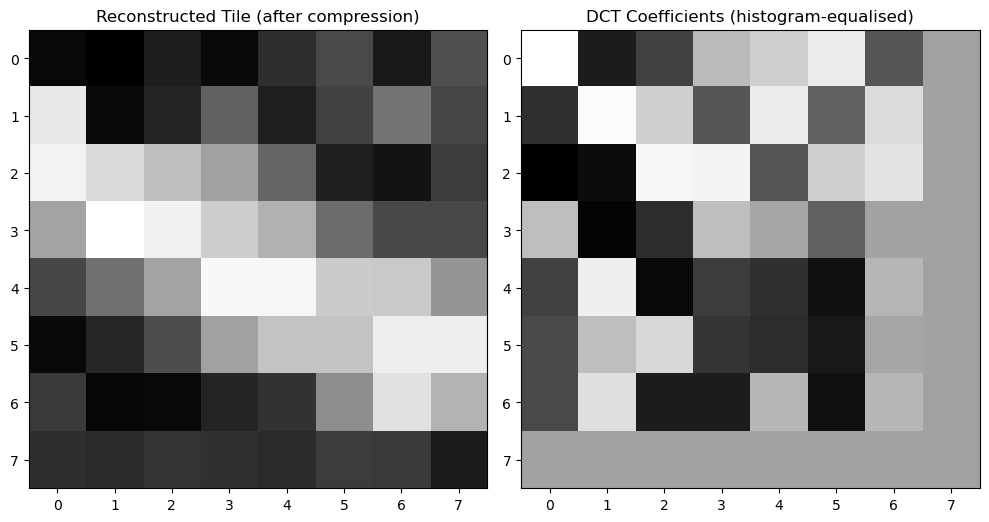

# Image Compression with the Discrete Cosine Transform

A Numerical Analysis project that demonstrates the core idea behind JPEG compression: split an image into 8×8 blocks, move each block into the frequency domain with the **2D Discrete Cosine Transform (DCT)**, throw away the highest-frequency coefficients, and transform back.

Everything lives in a single Jupyter notebook, [`Img Compress.ipynb`](Img%20Compress.ipynb).



## How it works

### 1. Convert to grayscale
The color image is collapsed to one luminance channel with a weighted sum of the RGB channels. Green gets the largest weight because the human eye is most sensitive to it.



### 2. Split into 8×8 tiles
The grayscale image is divided into non-overlapping 8×8 blocks, the same block size JPEG uses. Partial tiles at the right and bottom edges are skipped.

### 3. Apply the 2D DCT
Each tile is transformed with an orthonormal type-II DCT, applied along the rows and then the columns:

$$
X_{k} = \sum_{n=0}^{N-1} x_n \cos\left[\frac{\pi}{N}\left(n + \tfrac{1}{2}\right)k\right]
$$

After the transform, the top-left coefficient holds the block's average brightness (the DC term). Coefficients further toward the bottom-right represent finer and finer detail.

### 4. Low-pass filter
Any coefficient in the last row or last column of the block (index 7) is set to zero. This keeps 49 of the 64 coefficients and discards the highest-frequency detail, which the eye barely notices.

### 5. Reconstruct
The inverse DCT (columns, then rows) turns the filtered coefficients back into pixel values, and the tiles are reassembled into a full image.

### 6. Visualize
The notebook shows:
- a single reconstructed tile next to its DCT coefficients
- the full reconstructed image next to a map of every tile's DCT coefficients, with grid lines drawn at tile boundaries

The coefficient blocks are histogram-equalized before display, so the small high-frequency values remain visible beside the much larger DC term.



## Repository contents

| File | Description |
|------|-------------|
| `Img Compress.ipynb` | The notebook with all code and output |
| `finishedfinishedbeegyoshifinishedfinished.jpg` | Input image used by the notebook |
| `bird.jpg` | Alternative test image |
| `grayscale.png`, `single_tile.png`, `full_reconstruction.png` | Output figures used in this README |

## Running it

Requires Python 3 with NumPy, SciPy, and Matplotlib:

```bash
pip install numpy scipy matplotlib jupyter
jupyter notebook "Img Compress.ipynb"
```

To compress a different picture, change the filename in the first cell:

```python
im = mpimg.imread("bird.jpg")
```

To filter more aggressively, lower the cutoff in the second cell. For example, `if x > 3 or y > 3` keeps only the 16 lowest-frequency coefficients per block.

## Background

JPEG compression works on the same principle. Most of an image block's visual information is concentrated in a few low-frequency DCT coefficients, so the high-frequency ones can be discarded or coarsely quantized with little visible loss. Real JPEG goes further with a quantization table, zig-zag ordering, and entropy coding (Huffman or arithmetic), but the DCT step shown here is where the compression comes from.
